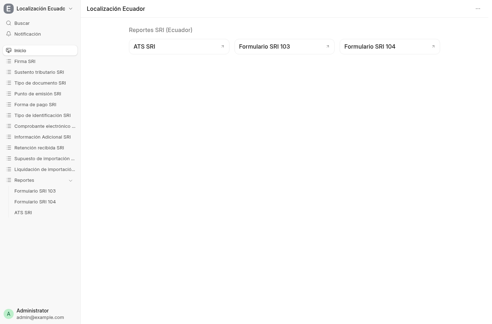
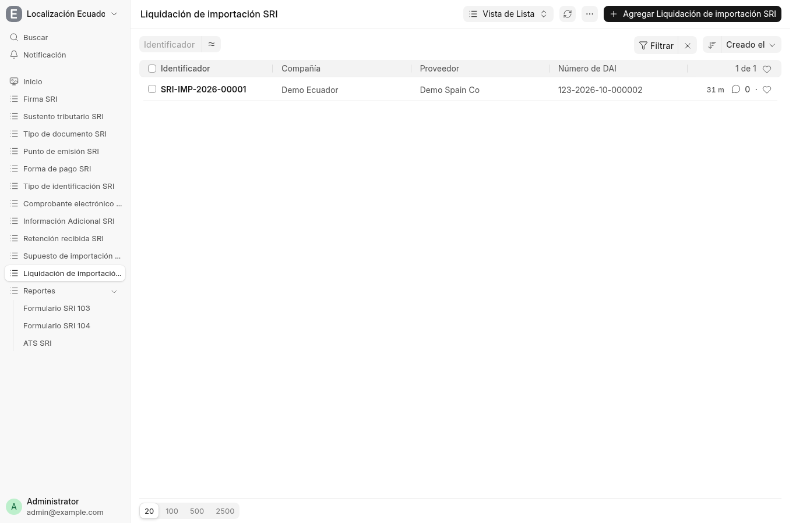

# 1. Espacio de trabajo Ecuador

`Localización Ecuador` en el Desk agrupa todo lo del SRI en un solo lugar:
catálogos a la izquierda, reportes arriba.

Los flujos nuevos viven acá: *Factura de Compra* (botones *Import
Supplier XML* / *Fetch Supplier XML by Key*, ver [página
2](02-factura-compra.md)), *Retención recibida SRI* (botón *Import
Customer XML*, ver [página 3](03-factura-venta.md)) y *SRI Import
Settlement* + *SRI Import Assumption* (ver [página
6](06-importaciones.md)).

La lista de *Retención recibida SRI* nace vacía en demo: se puebla importando el XML del cliente (ver [página 3](03-factura-venta.md)).

## Qué hay

**Catálogos** (tablas del SRI, editables desde el Desk):

| Catálogo | Norma SRI |
|---|---|
| Firma SRI | Certificado `.p12` para XAdES-BES |
| Sustento tributario SRI | Tabla 5 del ATS (01 bienes con crédito, 02 sin crédito, 03/04 activos fijos, 06/07 inventario…) |
| Tipo de documento SRI | 01 factura, 03 liquidación, 04 nota de crédito, 05 nota de débito, 06/07 retenciones… |
| Punto de emisión SRI | Establecimiento–punto (`001-001`) por canal (desk / POS / tienda) |
| Forma de pago SRI | Tabla 24 (01 sin utilización del sistema financiero, 16 tarjeta, 19/20/21…) |
| Tipo de identificación SRI | 04 RUC, 05 cédula, 06 pasaporte, 07 consumidor final… |
| Comprobante electrónico SRI | Cada XML generado/firmado/autorizado, con su clave de acceso |
| Información Adicional SRI | Campo `infoAdicional` del XML |
| Retención recibida SRI | Comprobantes de retención que emiten los clientes (manual + botón *Import Customer XML*) |
| Liquidación de importación SRI | Costos FOB/flete/seguro + DAI + botón LCV ([página 6](06-importaciones.md)) |
| Supuesto de importación SRI | Catálogo por empresa (ítem + partida + último AD VALOREM, solo estimado) |

**Reportes** (arriba, tarjetas grandes + sección Reportes):

- ATS SRI, Formulario SRI 103, Formulario SRI 104 (ver [página 5](05-reportes.md)).

## Dónde sigue

- Compras: [página 2](02-factura-compra.md) · Ventas: [página 3](03-factura-venta.md).
- Importaciones: [página 6](06-importaciones.md) · Reembolsos: [página 7](07-reembolsos.md).
