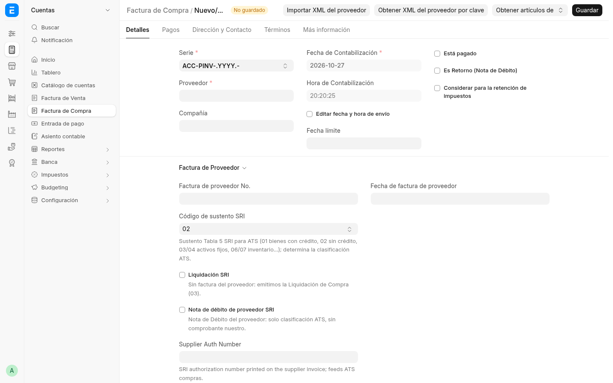
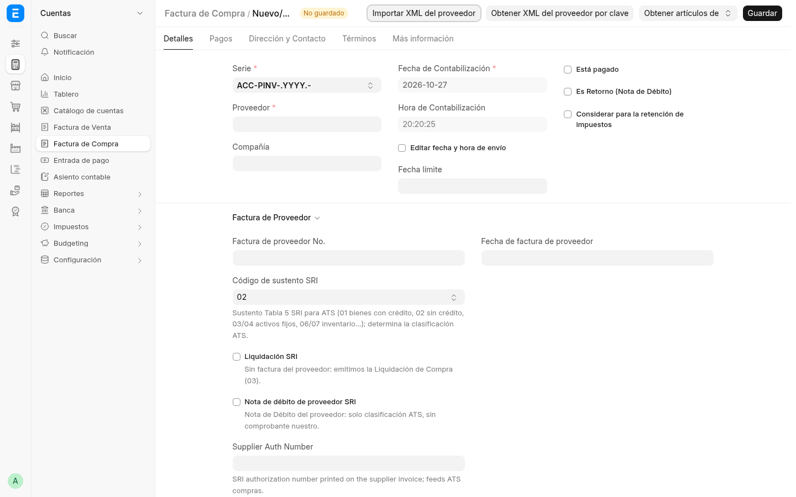
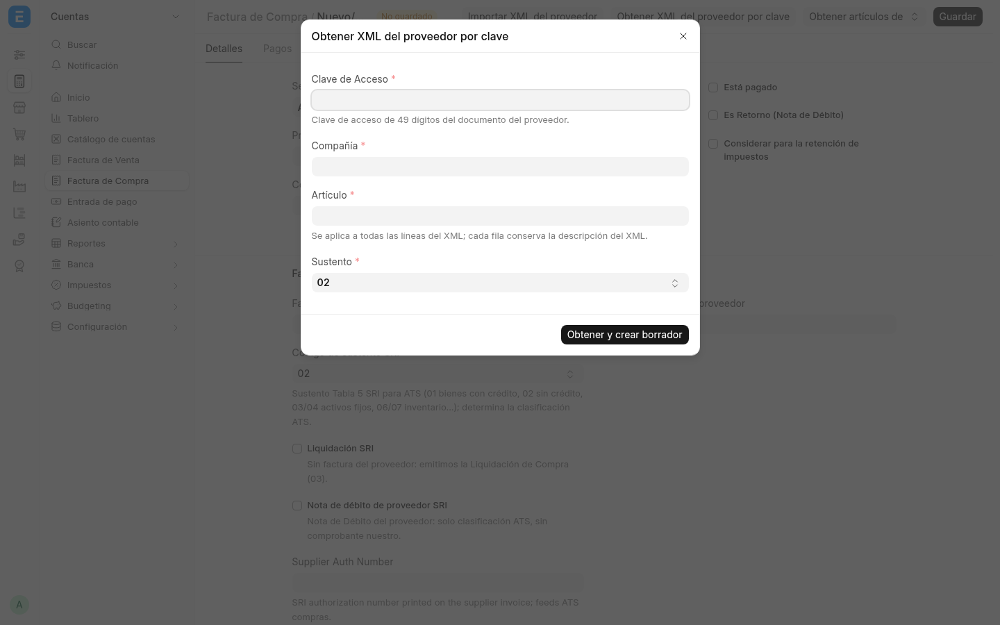

# 2. Factura de compra — sustento, liquidación y retenciones

La factura de compra (`ACC-PINV-…`) trae tres bloques SRI: identificación
del documento del proveedor, grilla de impuestos con cuentas NIIF y el
asiento de retención fiscal.

## Encabezado SRI del documento del proveedor

- **Código de sustento SRI** — Tabla 5 del ATS. El selector muestra
  código + leyenda (p. ej. `06`). Determina la clasificación en el ATS.
- **Liquidación SRI** — se marca cuando *no hay* factura del proveedor:
  emitimos nosotros la Liquidación de Compras (03).
- **Nota de débito de proveedor SRI** — solo clasifica como 05 en el ATS;
  no es un comprobante nuestro.
- **Supplier Auth Number** — autorización impresa en la factura del
  proveedor; alimenta el ATS de compras.
- **SRI Is Reimbursement** — se marca cuando el documento es un reembolso:
  como mandante, la `41` del intermediario (sustento según la naturaleza del
  gasto, p. ej. `01`); como intermediario que compra por cuenta del mandante,
  sustento `08`. Habilita la tabla **SRI Reimbursement Details** (un renglón
  por comprobante reembolsado: tipo, proveedor, número SRI, fechas, autorización
  y bases). El total `totbasesImpReemb` se calcula solo; el override manual
  exige el opt-in **Allow Reimbursement Override**.
  Contabilidad: los detalles son informativos (ATS/emisión) y nunca postean
  al mayor — el payable sale de los ítems. Los montos reembolsados no dan
  crédito fiscal: cargalos con plantilla sin IVA acreditable (0% / no objeto /
  exento); el IVA propio (tu comisión o bienes) viaja con su plantilla normal.
  En el ATS, lo reembolsado va en `<reembolsos>` y no suma a tus bases ni al 104.
- **Considerar para la retención de impuestos** (`sri_assumed_withholding`) —
  retenciones **asumidas**: el proveedor no retiene y nosotros asumimos el
  gasto sin tocar su cuenta por pagar (el pasivo con el proveedor queda
  intacto).
- **Facturas del exterior sin IVA local** — un proveedor extranjero nunca
  cobra IVA ecuatoriano: sus líneas van sin plantilla de impuestos y la
  app lo exige (falla si traen IVA). El crédito nace de la liquidación de
  aduana (DAI), que se acumula en el documento **SRI Import Settlement**,
  no de la factura del proveedor.
- **Importar XML del proveedor** — walkthrough abajo (pasos 1–4).

## Grilla de impuestos y cargos

Cada fila usa una cuenta del plan NIIF (`1010504 - IVA PAGADO`, `2010709 -
RETENCIÓN DE IR POR PAGAR`) con su descripción en patrón SRI
(`IVA Pagado 15%`, `Ret. IR 0%`). Debajo, el formulario separa impuestos
adicionales, deducibles y el total neto — lo que alimenta ATS y 104.

## Walkthrough: importar una factura del proveedor (pasos 1–4)

**Paso 1 — Abrí una factura de compra nueva.** Arriba aparecen los dos
botones de recepción junto a *Guardar*.

**Paso 2 — *Import Supplier XML* (archivo).** Elegí empresa, ítem (se
aplica a todas las líneas; la descripción del XML se conserva por
renglón), sustento (el XML no lo trae, lo elegís vos) y adjuntá el XML
firmado del proveedor. Sirve de cualquier antigüedad: no depende del SRI.

*Import as Draft* prellena proveedor, número `estab-pto-secuencial`,
fechas, autorización e ítems con su plantilla de IVA (matcheada por tarifa
exacta entre las plantillas de compra de lado débito) y crea el borrador
para tu revisión.

**Paso 3 — Alternativa: *Fetch Supplier XML by Key*.** Mismo borrador,
pero trayendo el XML autorizado desde el SRI con la clave de 49 dígitos.
El SRI responde solo autorizaciones recientes (~10 días en la práctica,
sin SLA): si no responde, subí el archivo (paso 2).

**Paso 4 — Revisá el borrador.** Si el proveedor no existe, se crea solo
bajo el grupo `Imported Suppliers` (revisá sus datos después); si el
nombre ya existe con otro RUC, falla en voz alta sin mezclar
contribuyentes. Si ninguna plantilla calza con la tarifa del XML, el error
te lista las disponibles. Duplicados (mismo proveedor + número) se
rechazan nombrando el documento existente.

Notas de archivo real: los XML llegan dentro del sobre `<autorizacion>`
(CDATA, incl. docs v2.1.0) — el lector lo desenvuelve y prefiere
`numeroAutorizacion`; variantes como `DOLAR US` normalizan a USD;
facturas multi-tasa mapean por línea; solo facturas (las NC se rechazan);
secuenciales de 6 dígitos tipo Banco (`027-002-000131800`) se parten
natural.

## Dónde sigue

- Lo que emite el cliente cuando nos retiene: [página 3](03-factura-venta.md).
- Cómo estas compras caen al ATS: [página 5](05-reportes.md).
