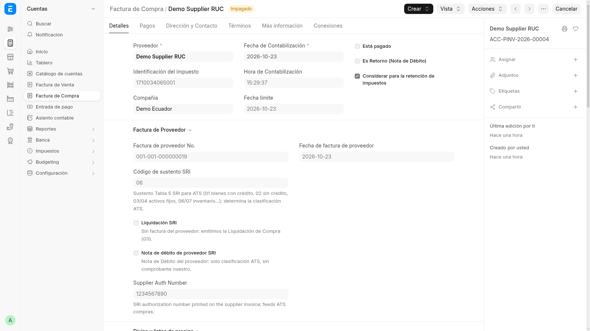
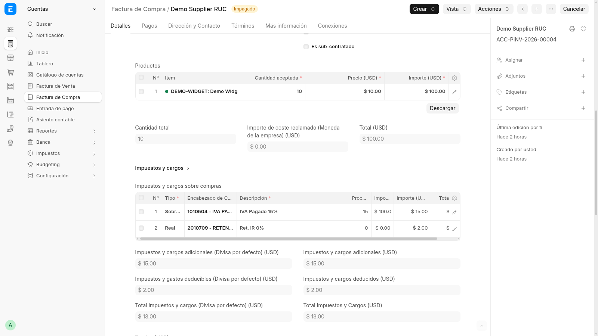

# 2. Factura de compra — sustento, liquidación y retenciones

La factura de compra (`ACC-PINV-…`) trae tres bloques SRI: identificación
del documento del proveedor, grilla de impuestos con cuentas NIIF y el
asiento de retención fiscal.

## Encabezado SRI del documento del proveedor

- **Código de sustento SRI** — Tabla 5 del ATS. El selector muestra
  código + leyenda (p. ej. `06`). Determina la clasificación en el ATS.
- **Liquidación SRI** — se marca cuando *no hay* factura del proveedor:
  emitimos nosotros la Liquidación de Compras (03).
- **Nota de débito de proveedor SRI** — solo clasifica como 05 en el ATS;
  no es un comprobante nuestro.
- **Supplier Auth Number** — autorización impresa en la factura del
  proveedor; alimenta el ATS de compras.
- **Considerar para la retención de impuestos** (`sri_assumed_withholding`) —
  retenciones **asumidas**: el proveedor no retiene y nosotros asumimos el
  gasto sin tocar su cuenta por pagar (el pasivo con el proveedor queda
  intacto).

## Grilla de impuestos y cargos

Cada fila usa una cuenta del plan NIIF (`1010504 - IVA PAGADO`, `2010709 -
RETENCIÓN DE IR POR PAGAR`) con su descripción en patrón SRI
(`IVA Pagado 15%`, `Ret. IR 0%`). Debajo, el formulario separa impuestos
adicionales, deducibles y el total neto — lo que alimenta ATS y 104.

## Dónde sigue

- Lo que emite el cliente cuando nos retiene: [página 3](03-factura-venta.md).
- Cómo estas compras caen al ATS: [página 5](05-reportes.md).
