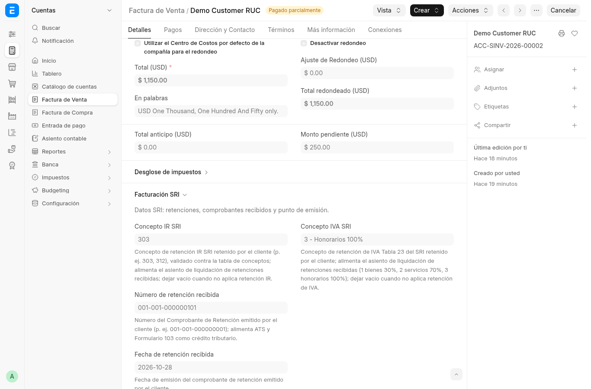
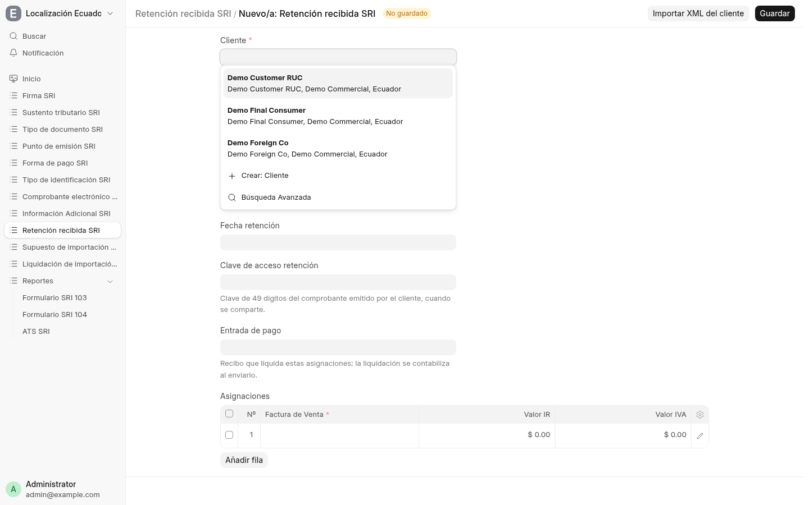
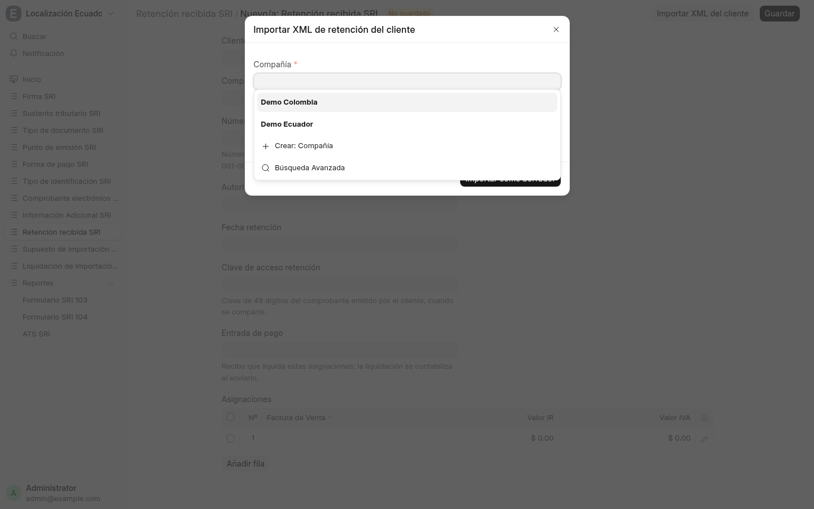

# 3. Factura de venta — sección Facturación SRI

La factura de venta (`ACC-SINV-…`) colapsa lo tributario en la sección
**Facturación SRI**: conceptos de retención, comprobante de retención
recibido del cliente y punto de emisión.

## Campos

- **Concepto IR SRI** (`303`, `307`, `312`…) — concepto de retención de
  Renta que nos aplica el cliente; validado contra la tabla de 176
  conceptos. Alimenta el asiento de liquidación de retenciones recibidas.
- **Concepto IVA SRI** (`1` bienes 30%, `2` servicios 70%, `3` honorarios
  100%…) — Tabla 23 de retenciones de IVA.
- **Número / Autorización / Clave de acceso de retención recibida** —
  el comprobante de retención (06/07) que emite el cliente: número
  `001-001-…`, autorización del SRI y clave de 49 dígitos. Alimenta ATS
  (crédito) y Formulario 103.
- **Fecha de retención recibida** — fecha de emisión del comprobante
  del cliente.

En la captura, el cliente retuvo IR concepto `303` e IVA concepto `3`
(honorarios 100%) con comprobante `001-001-000000101`.

## Walkthrough: importar la retención del cliente (pasos 1–3)

**Paso 1 — Abrí *Retención recibida SRI* nuevo.** El botón *Import
Customer XML* está arriba junto a *Guardar*; abajo, la tabla
*Asignaciones* espera las facturas de venta imputadas.

**Paso 2 — *Import Customer XML*.** Elegí empresa y adjuntá el XML 07
donde somos sujeto retenido. El lector crea el lote borrador: número SRI,
autorización (= clave en esquema offline), fecha, cliente por RUC e
imputaciones IR/IVA por documento sustento.

**Paso 3 — Revisá el lote.** El cliente debe existir (falla en voz alta
pidiendo crearlo primero). Cada sustento se auto-vincula a su factura de
venta enviada y autorizada por coincidencia exacta (cliente + número); si
no hay match único, la importación se detiene y lo imputás manual
después. Duplicados (mismo cliente + número) se rechazan nombrando el
lote existente. Aguas abajo sigue el flujo existente (timbre, liquidación,
103/104).

## Dónde sigue

- El XML que generamos nosotros por esta venta: [página 4](04-comprobantes.md).
- Dónde aparece el crédito de esta retención: [página 5](05-reportes.md).
