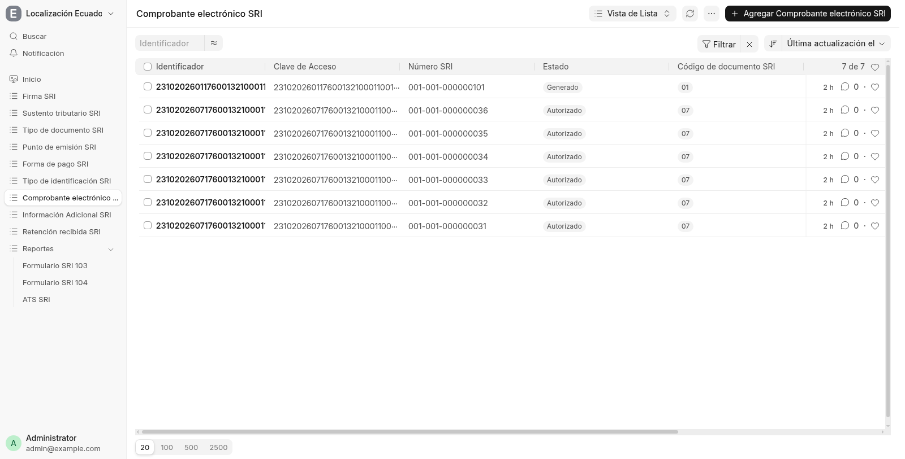
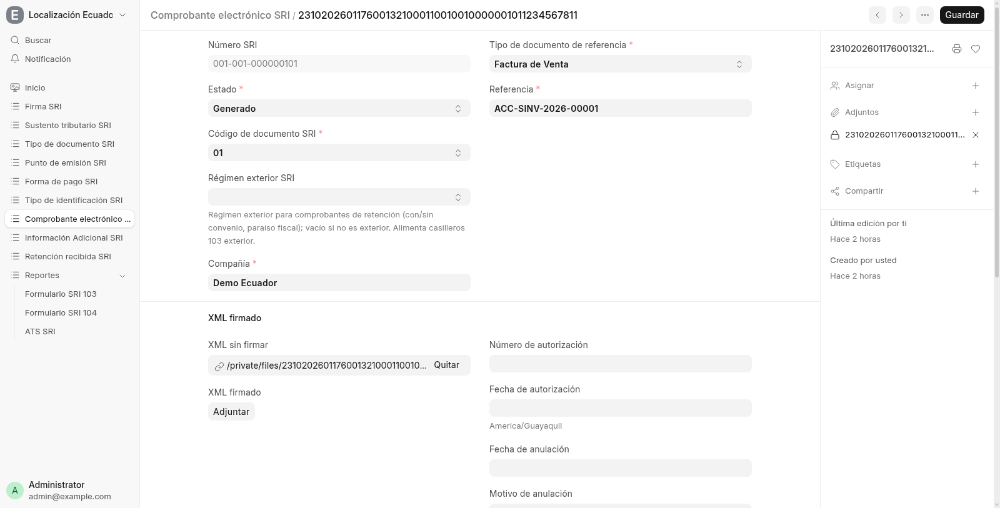
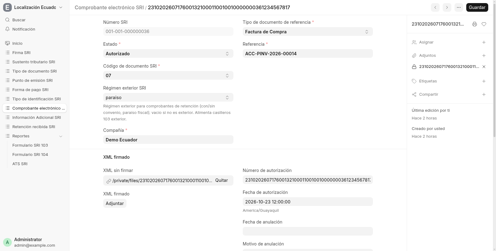

# 4. Comprobantes electrónicos — 01 y 07

Cada documento tributario genera un **Comprobante electrónico SRI** con su
clave de acceso de 49 dígitos (Modulo 11), XML sin firmar → firmado,
número SRI y estado (`Generado`, `Autorizado`, `Rechazado`, `Anulado`).

## Lista

Siete comprobantes demo: una factura **01** en `Generado` y seis
retenciones **07** en `Autorizado` (exterior, ver abajo).

## Factura 01 generada

Referencia la factura `ACC-SINV-2026-00001`, trae el XML sin firmar
adjunto y aún no tiene número de autorización: con el certificado de
prueba autofirmado el SRI real respondería `FIRMA INVALIDA`, así que en
demo queda en `Generado`. Con un certificado real el flujo sigue a
firmar → enviar → autorizado, con RIDE y email automáticos.

## Retención 07 autorizada (exterior)

Referencia la compra `ACC-PINV-2026-00014`, código `07`, **régimen
exterior `paraiso`** (paraíso fiscal: sin convenio / con convenio /
paraíso). Número de autorización y fecha del SRI registrados. Estos
estados `Autorizado` son representados en demo (ver [HOME](HOME.md)) y
alimentan el Formulario 103 exterior (casilleros 497/498).

## Dónde sigue

- Dónde caen estos comprobantes: [página 5](05-reportes.md).
