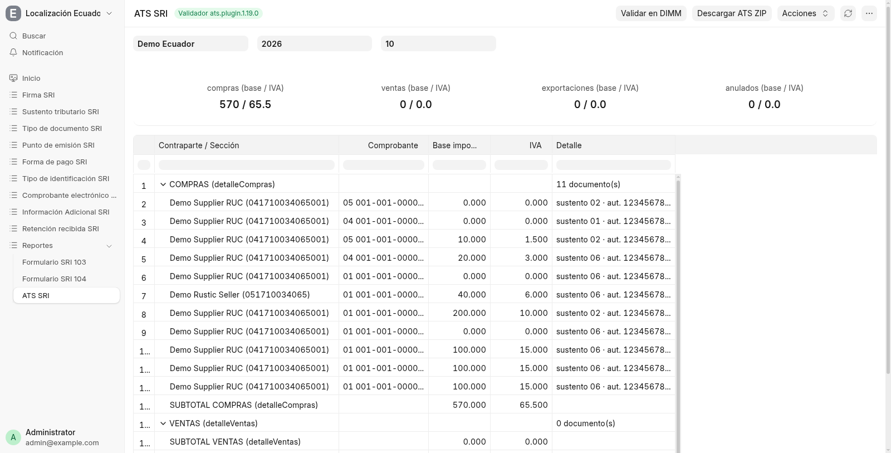
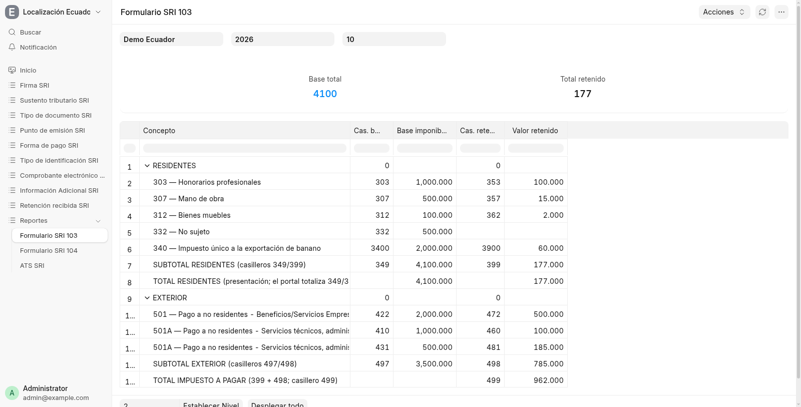
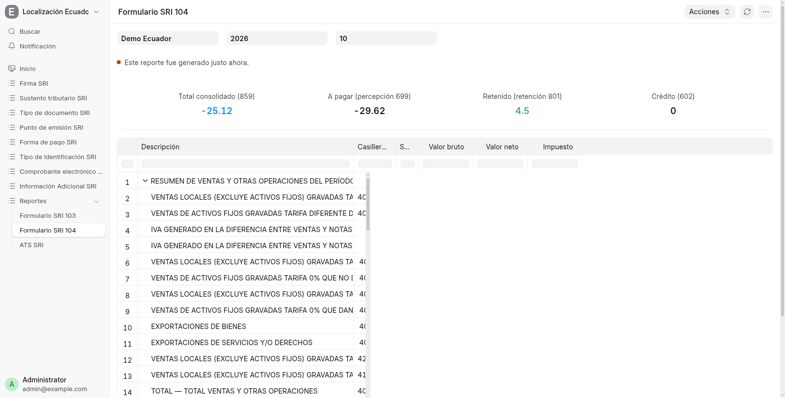

# 5. Reportes SRI — ATS, 103 y 104

Tres reportes en el workspace, con filtros `company / year / month`,
insignia de frescura («generado justo ahora») y tarjetas de totales.

## ATS SRI

- Tarjetas: compras / ventas / exportaciones / anulados (base / IVA).
- Grilla por contraparte con código de documento (`01`, `04`, `05`),
  número SRI, base, IVA, sustento y autorización.
- Botones **Validar en DIMM** (validador `ats.plugin.1.19.0` como
  sidecar) y **Descargar ATS ZIP**.
- Las NC (`04`) y ND (`05`) del proveedor exigen número SRI válido: el
  lector falla en voz alta si no lo es; las `01` con número no-SRI se
  excluyen en silencio.

## Formulario SRI 103 (retenciones en la fuente)

- **RESIDENTES**: conceptos 303 (honorarios), 307 (mano de obra), 312,
  332… con casillero de base y de retenido, subtotal 349/399.
- **EXTERIOR**: pagos a no residentes (501…) con casilleros 497/498 y
  total a pagar 499 — alimentado por las 07 con régimen exterior.
- Tarjetas: base total y total retenido del mes.

## Formulario SRI 104 (IVA mensual)

- Bloques DIMM por casillero (ventas 0% / 5% / tarifa variable,
  exportaciones, notas de crédito, liquidación del IVA del mes…).
- Tarjetas: total consolidado (859), a pagar (percepción 699), retenido
  (801) y crédito (602).

## Nota de datos demo

Ventas en ATS figura en `0` porque las ventas demo no tienen comprobante
autorizado (techo autofirmado); el 104 sí las consolida desde las
facturas. Las autorizaciones `1234567890` son marcadores de ejemplo.
