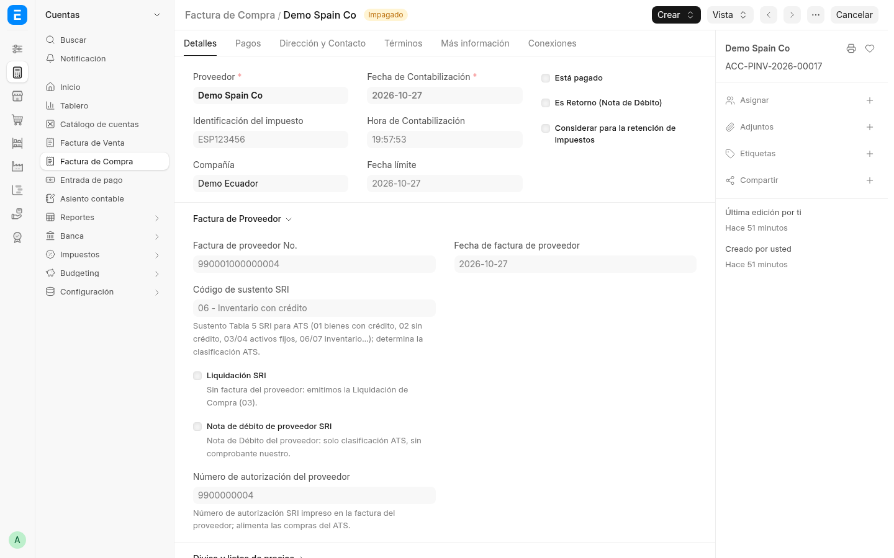
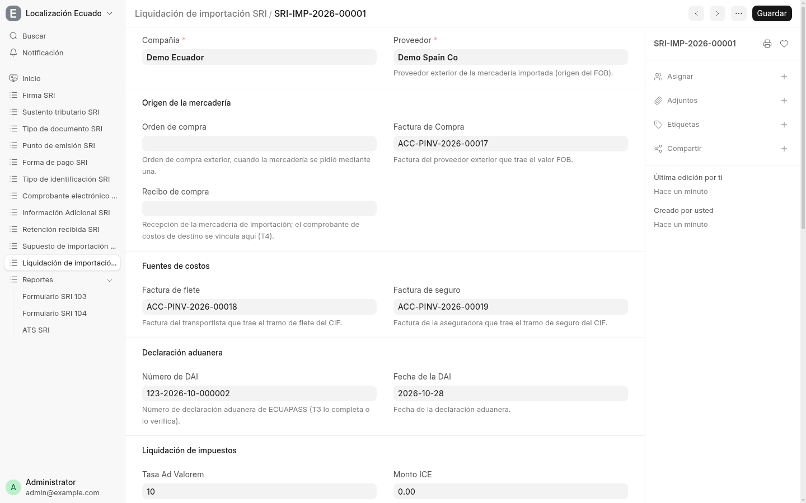
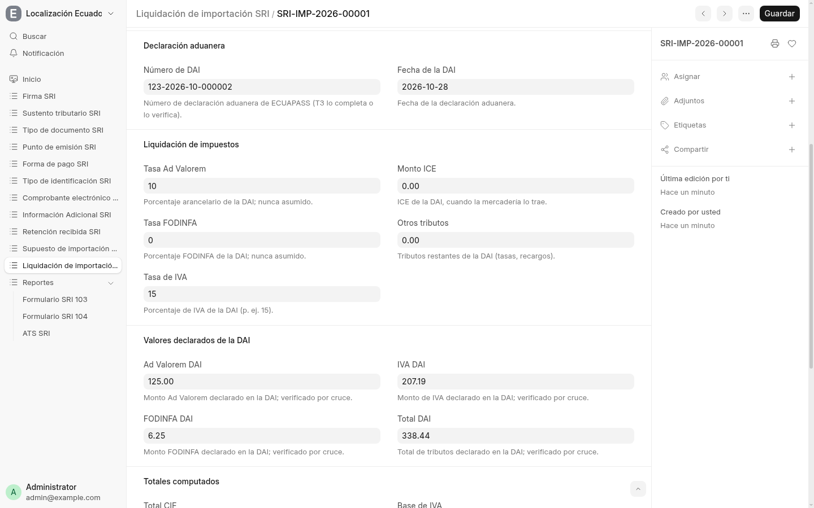
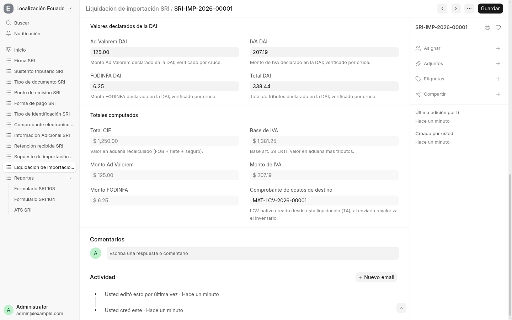
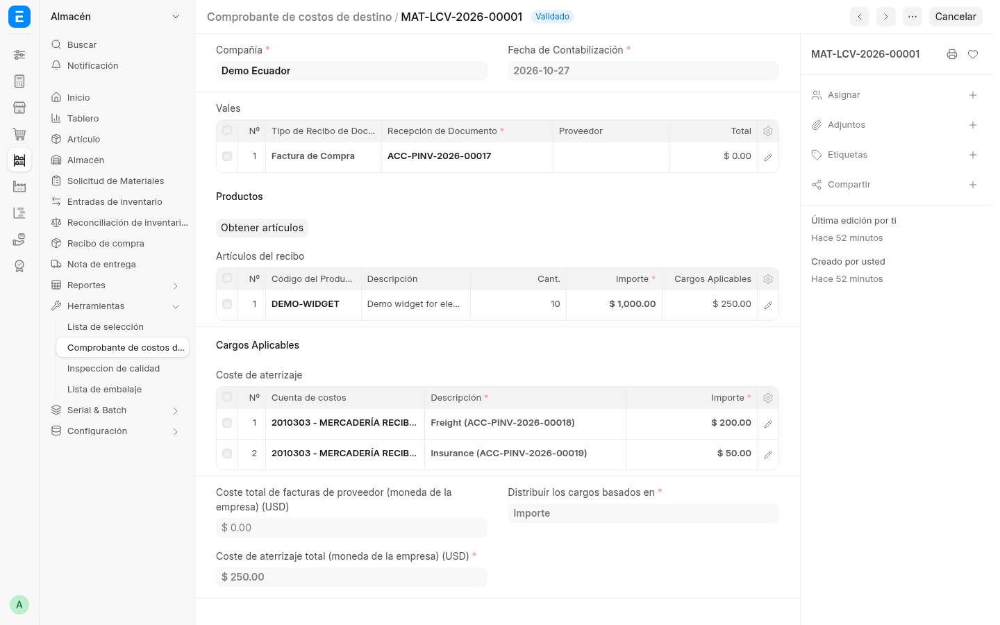

# 6. Importaciones — del exterior al recosteo (pasos 0–5)

Compra al exterior → acumulación de costos (FOB/flete/seguro) → liquidación
de impuestos (AD VALOREM, FODINFA, IVA art. 59 LRTI) → reportes + recosteo
con Landed Cost Voucher nativo. Documentos: facturas `990…`, **SRI Import
Settlement**, LCV nativo. La demo trae el caso completo: mercadería
`ACC-PINV-2026-00017` (`990001000000004`), flete `…-00018`, seguro
`…-00019`, liquidación `SRI-IMP-2026-00001` y LCV `MAT-LCV-2026-00001`.

## Paso 0 — La factura exterior (sin IVA local)

Un proveedor extranjero nunca cobra IVA ecuatoriano: sus líneas van sin
plantilla de impuestos y la app lo exige (falla si traen IVA). El número
es la corrida exterior de 15 dígitos y la autorización, la de aduana. El
crédito nace de la liquidación (DAI), nunca de esta factura.

## Paso 1 — Vinculá los documentos fuente

Compañía y proveedor exterior (fuente del FOB), más la orden / recepción /
factura del exterior y las facturas de flete y seguro. Todo en una sola
moneda; mezclar monedas falla en voz alta. Los vinculados deben existir,
ser de la misma empresa y no estar anulados. El FOB sale del neto de la
factura exterior (sin impuestos), si no de la recepción u orden.

## Paso 2 — Declaración de aduana (DAI)

Transcribí una fila canónica de DAI (número, fecha, tasas, valores
declarados) o cargá las tasas a mano. Las tasas vienen de la DAI, nunca
hardcodeadas: si el catálogo de la empresa (**SRI Import Assumption**:
empresa + ítem + partida + último AD VALOREM) tiene una sola tasa para
esos bienes, la prellena como estimado; la DAI siempre arbitra. Al guardar
se recalcula y se cruza: si la aritmética no calza con la DAI, falla
nombrando la tasa.

## Paso 3 — Totales y recosteo

CIF, AD VALOREM, FODINFA, base y monto de IVA quedan estampados (en la
moneda de la compañía). El botón de crear el LCV genera el Landed Cost
Voucher nativo contra la recepción (o la factura exterior con Update
Stock), con flete/seguro como legs; un segundo llamado falla en vez de
duplicar costo. El LCV repostea valoración (SLE/GLE) con prorrateo por
monto.

## Paso 4 — Recosteo: el LCV creado desde la liquidación

El botón de la liquidación genera el LCV nativo contra la recepción (o
la factura exterior con Update Stock), con flete y seguro como tramos de
costo. Al enviarlo, ERPNext repostea la valoración (SLE/GLE) con
prorrateo por monto: en la demo, `DEMO-WIDGET` ×10 a $1,000.00 absorbe
$250.00 de flete + seguro.

## Paso 5 — Reglas fiscales

- La factura del proveedor extranjero nunca lleva IVA local: sus líneas
  van sin plantilla y la app lo exige. El crédito nace de la liquidación
  (DAI), no del proveedor.
- En ATS, las compras exterior de 15 dígitos (`990001000000001` →
  `990-001-000000001`) sí entran con tipo de identificación exterior;
  las `01` locales con número no-SRI se excluyen en silencio.
- En 104 hay casilleros dedicados de importación; quedan en 0 hasta que
  exista el documento de impuestos de la DAI.

## Dónde sigue

- Cómo estas compras caen al ATS/104: [página 5](05-reportes.md).
- Volver al [índice](HOME.md).
