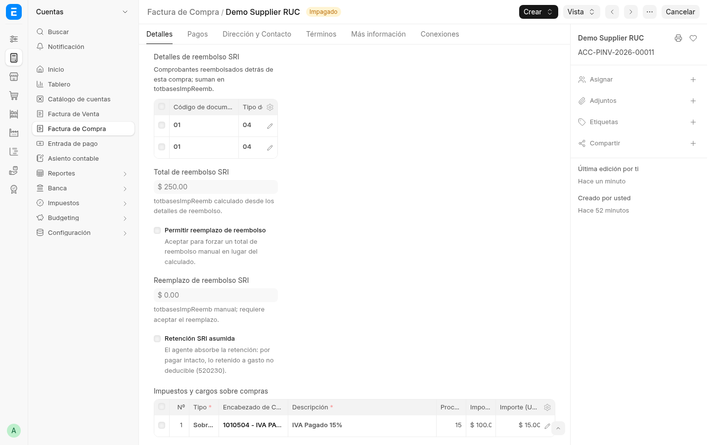
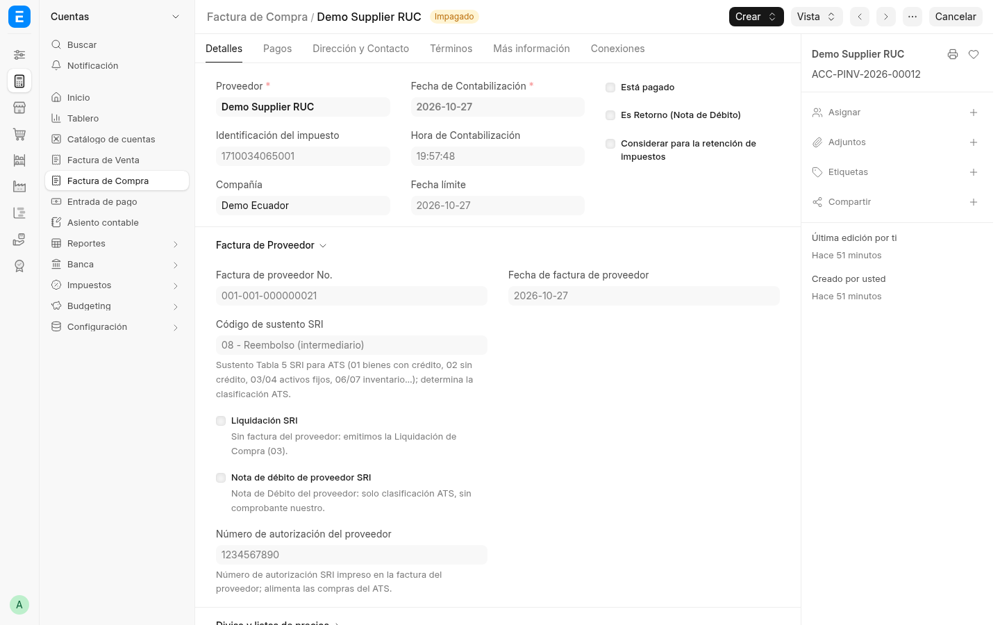

# 7. Reembolsos — liquidación de compras por reembolso (pasos 1–4)

Cuando comprás por cuenta de un mandante (o te reembolsan gastos), el SRI
pide un bloque propio: cada comprobante reembolsado viaja con tipo,
proveedor, número SRI, fechas, autorización y bases, y el total
`totbasesImpReemb` se calcula solo. La demo trae el par completo:
mandante (`ACC-PINV-2026-00011`, factura `001-001-000000020`) e
intermediario (`ACC-PINV-2026-00012`, factura `001-001-000000021`).

## Paso 1 — Rol mandante: factura que recibe el reembolso

Abrí la factura del mandante y bajá hasta **Detalles de reembolso SRI**
(un renglón por comprobante reembolsado). El **Total de reembolso SRI**
sale de las filas; el reemplazo manual exige el opt-in **Permitir
reemplazo de reembolso**.

En la demo: 2 comprobantes (`001-002-000000031/032`), total `250.00`.
Contabilidad: los detalles son informativos (ATS/emisión) y nunca postean
al mayor — el payable sale de los ítems. Los montos reembolsados no dan
crédito fiscal: cargalos con plantilla sin IVA acreditable; el IVA propio
viaja con su plantilla normal.

## Paso 2 — Rol intermediario: compra por cuenta del mandante

Quien compra por cuenta ajena usa sustento `08 - Reembolso
(intermediario)` (el mandante usa el sustento según la naturaleza del
gasto, p. ej. `01`).

## Paso 3 — Emisión y ATS

La factura de venta del mandante (01) y la liquidación de compras (03)
emiten el bloque `<reembolsos>` en el XML. En el ATS, lo reembolsado va
en `<reembolsos>` con el total `totbasesImpReemb` y **no** suma a tus
bases ni al 104. El Formulario 103/104 no se toca por diseño
(regresión pineada).

## Paso 4 — Reglas

- Un renglón por comprobante: tipo, proveedor, número SRI, fechas,
  autorización y bases (gravada / no objeto / exenta / IVA / ICE).
- `codDocReembolso` único por factura (códigos mixtos fallan); ICE exige
  desglose explícito.
- El total es calculado; el override manual sin opt-in falla en voz alta.

## Dónde sigue

- Compras en general: [página 2](02-factura-compra.md).
- Dónde caen los reembolsos en el ATS: [página 5](05-reportes.md).
- Volver al [índice](HOME.md).
